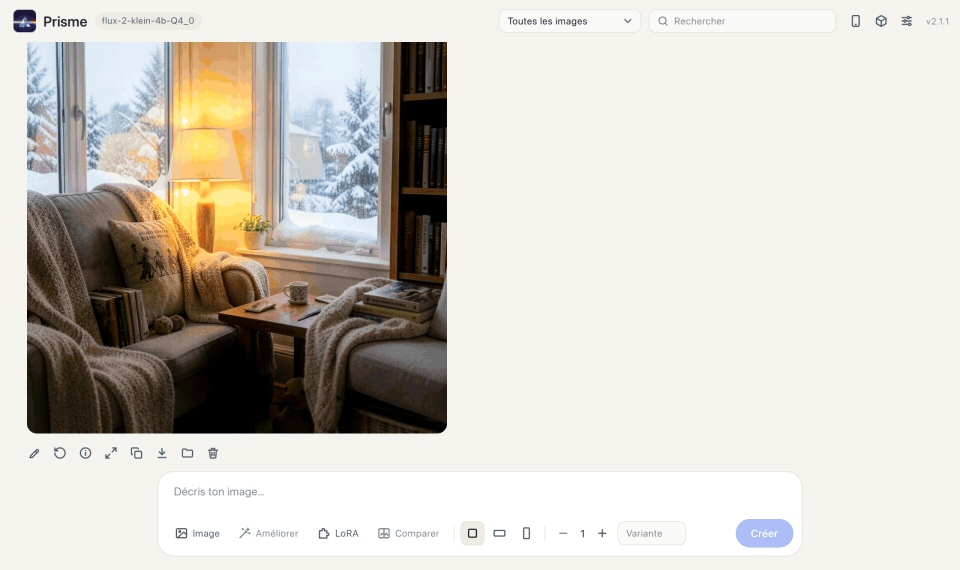
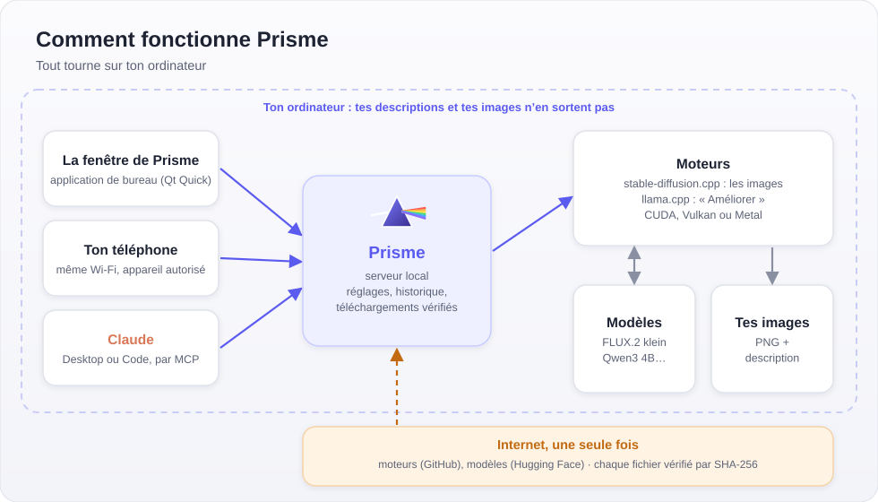
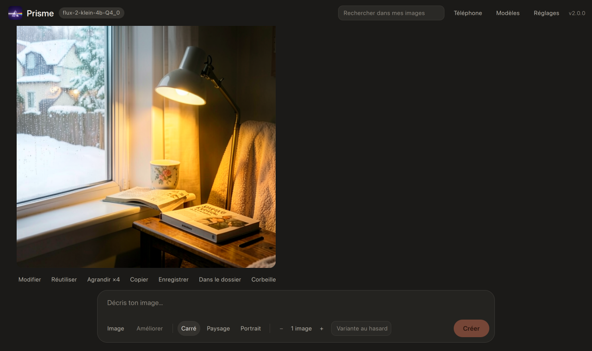
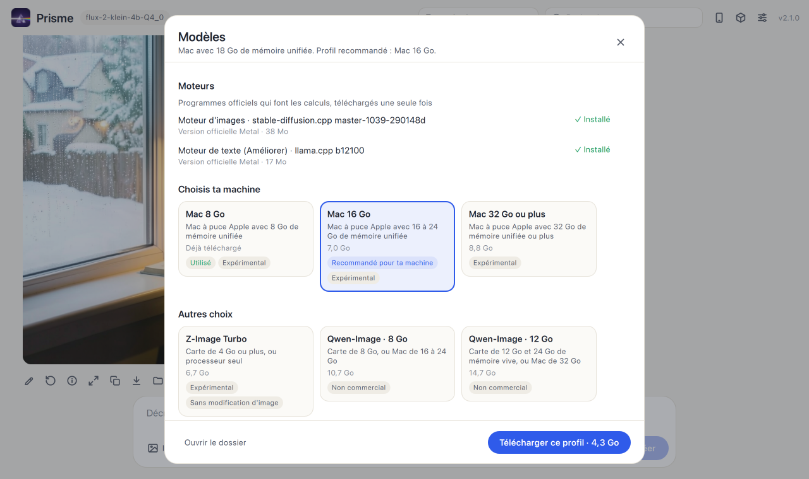
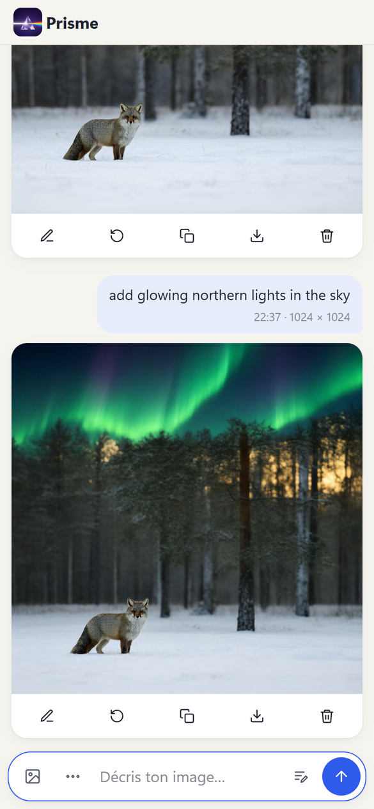
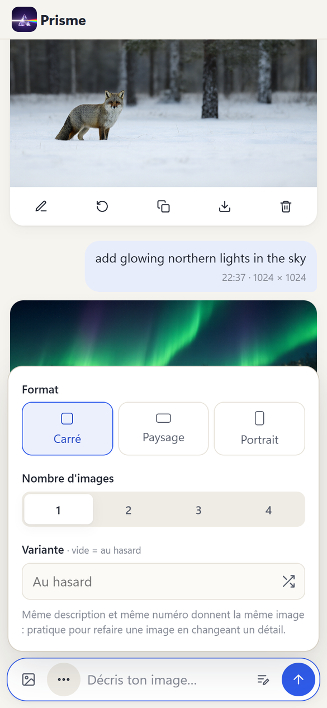
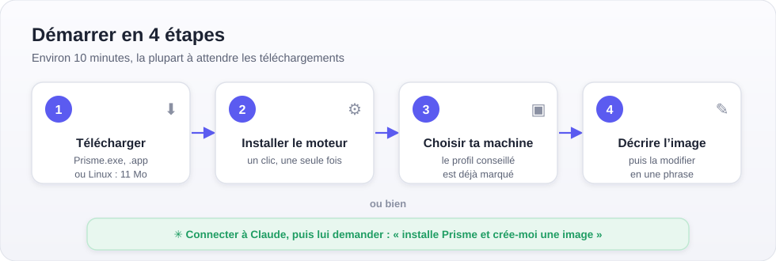
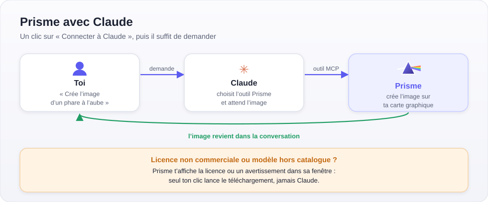

<p align="center">
  
</p>

<h1 align="center">Prisme</h1>

<p align="center">
  <strong>Un générateur d'images IA local, gratuit et open source, pour Windows, macOS et Linux.</strong><br>
  Crée et modifie des images sur ton ordinateur : sans cloud, sans abonnement, sans installation compliquée.
</p>

<p align="center">
  <a href="https://github.com/d3Ita/prisme/releases/latest"></a>
  <a href="https://github.com/d3Ita/prisme/actions/workflows/tests.yml"></a>
  <a href="LICENSE"></a>
  <br>
  
  
  
  
  
  
  <a href="https://github.com/leejet/stable-diffusion.cpp"></a>
  
</p>

<p align="center">
  <a href="README.md">English</a> · <strong>Français</strong>
</p>

<p align="center">
  <a href="https://d3ita.github.io/prisme/"><strong>Site</strong></a> ·
  <a href="#installation">Installation</a> ·
  <a href="#choisir-ses-modèles-selon-sa-machine">Modèles</a> ·
  <a href="#utilisation">Utilisation</a> ·
  <a href="#construire-depuis-les-sources">Construire</a> ·
  <a href="#roadmap">Roadmap</a> ·
  <a href="#utiliser-prisme-avec-claude-via-mcp">Claude (MCP)</a> ·
  <a href="#sécurité">Sécurité</a> ·
  <a href="#questions-fréquentes">Questions</a> ·
  <a href="#licence">Licence</a>
</p>

Application locale pour créer et modifier des images par intelligence artificielle sur Windows, macOS et Linux. Tout tourne sur ton ordinateur : pas de compte, pas d'abonnement, pas d'envoi de tes images sur Internet. Le calcul est fait par la carte graphique grâce à [stable-diffusion.cpp](https://github.com/leejet/stable-diffusion.cpp). Il faut Internet une seule fois, pour télécharger le moteur et les modèles : ensuite, Prisme marche hors ligne.



### Pour qui ?

- **Ceux qui découvrent la génération d'images en local** et veulent des résultats sans apprendre un éditeur de nœuds
- **Les créateurs** qui veulent garder leurs descriptions et leurs images privées, sur leur machine
- **Ceux qui en ont assez des abonnements et des crédits** des générateurs en ligne
- **Les familles et petites équipes** qui veulent profiter de la carte graphique d'un PC depuis leurs téléphones



C'est une alternative simple à ComfyUI et aux générateurs d'images en ligne : moins de possibilités avancées, beaucoup moins de complexité.

## Fonctions

- **Création** d'images à partir d'une description, de 1 à 4 images par lancement
- **Amélioration de la description** par un modèle de langage local, à la demande ou automatiquement, en création comme en modification
- **Installation automatique** des moteurs au premier lancement : CUDA pour les cartes NVIDIA, Vulkan pour les cartes AMD et Intel
- **Téléchargement des modèles dans l'appli** : un clic récupère les modèles officiels conseillés, reprend si c'est interrompu et vérifie chaque fichier
- **Suppression des modèles dans l'appli** : libérer de la place depuis la fenêtre des modèles, sans ouvrir le dossier `models`
- **Modification** d'une image existante : glisser, coller ou choisir une image de départ
- **Agrandissement** ×4 d'une image terminée avec Real-ESRGAN : un clic sous l'image, les détails restent nets
- **Formats** carré, paysage, portrait, ou proportions de l'image de départ
- **Disposition en conversation** : tes demandes et les images de Prisme se suivent comme dans une messagerie, avec recherche, visionneuse plein écran, réutilisation d'une description et mise à la corbeille
- **Thème clair ou sombre**, ou celui du système
- **Interface en français ou en anglais**, selon la langue de l'appareil ou au choix dans **Réglages → Application → Langue**
- **Réglages** : choix des modèles, LoRA, étapes, CFG, échantillonneur, sigmas, options mémoire
- **Téléphone** : utilisation depuis un téléphone sur le même Wi-Fi, protégée par un code d'accès (QR code)
- **Un seul programme** pour Windows, macOS ou Linux, sans Python à installer

## Captures

<table>
  <tr>
    <td></td>
    <td></td>
  </tr>
  <tr>
    <td align="center">Thème sombre sur ordinateur</td>
    <td align="center">Les modèles conseillés, téléchargés en un clic</td>
  </tr>
</table>
<table>
  <tr>
    <td></td>
    <td></td>
  </tr>
  <tr>
    <td align="center">Sur un téléphone, avec le Wi-Fi de la maison</td>
    <td align="center">Format et nombre d'images dans le panneau d'options</td>
  </tr>
</table>

## Prérequis

| Système | Fichier | Carte graphique | État |
|---|---|---|---|
| Windows 10 ou 11 | `Prisme.exe` | NVIDIA (CUDA), ou AMD et Intel (Vulkan) ; 8 Go de mémoire vidéo ou plus conseillés | Testé |
| macOS 13 ou plus récent | `Prisme-macOS-arm64.dmg` | Puce Apple (M1 ou plus récente, Metal), 16 Go de mémoire ou plus conseillés | Testé sur M3 |
| Linux x64 (Ubuntu 24.04 ou équivalent) | `Prisme-Linux-x64.tar.gz` | Toute carte avec un pilote Vulkan | Expérimental |

Il faut aussi des modèles compatibles avec stable-diffusion.cpp (GGUF ou safetensors, voir [Choisir ses modèles selon sa machine](#choisir-ses-modèles-selon-sa-machine)) et une connexion Internet au premier lancement, pour l'installation des moteurs.

Prisme pilote les modèles qui fonctionnent avec un modèle de diffusion, un encodeur de texte de type LLM (`--llm`), un VAE et, pour la modification d'image, un encodeur d'image (`--llm_vision`).

### Configuration testée

| Carte graphique | Mémoire vive | Modèles | Temps pour une image de 1024 × 1024 |
|---|---|---|---|
| NVIDIA RTX 4070 SUPER, 12 Go (CUDA, Windows 11) | 32 Go | Ensemble conseillé : modèle de dessin Q4_K, modèle de texte Q8_0, vision F16 | Création 25 à 50 s, modification 45 à 90 s, chargement des modèles compris |
| La même carte avec le moteur Vulkan | 32 Go | Mêmes modèles | Environ 50 s pour une création, chargement compris |
| NVIDIA RTX 4070 SUPER, 12 Go (CUDA, Windows 11) | 32 Go | FLUX.2 klein 4B Q8_0, Qwen3 4B Q8_0 (profil Carte de 12 Go) | Création 8 à 10 s, modification 10 à 12 s en 1024 × 768 |
| Apple M3, 18 Go de mémoire unifiée (Metal, macOS) | 18 Go (partagés) | Ensemble complet (avant les versions légères conseillées sur Mac) | Environ 5 minutes pour une création, chargement compris |
| NVIDIA RTX 4070 SUPER, 12 Go (CUDA, Windows 11) | 32 Go | Real-ESRGAN x4plus | Agrandissement de 1280 × 704 en 5120 × 2816 : 14 s |

Les autres cartes n'ont pas encore été mesurées. Pour se repérer : avec 8 Go de mémoire vidéo, choisis le modèle de dessin Q4_K et le modèle de texte Q4_K_M, et laisse **Décharger sur le processeur** activé ; 16 Go de mémoire vive ou plus aident, car une partie des modèles y attend son tour. Prévois environ 16 Go libres sur le disque pour le moteur et les modèles conseillés. Tes résultats sur d'autres machines sont les bienvenus dans les [Discussions](https://github.com/d3Ita/prisme/discussions/categories/show-and-tell).

## Installation



1. Télécharge le fichier de ton système depuis le [site](https://d3ita.github.io/prisme/#download) ou la page des versions ([Releases](../../releases)), ou construis-le (voir plus bas). Le site garde une copie de la dernière version, qui marche même quand les liens de téléchargement de GitHub sont en panne (empreintes dans [SHA256SUMS.txt](https://d3ita.github.io/prisme/telechargements/SHA256SUMS.txt)).
2. Lance Prisme, puis clique sur **Installer le moteur** : Prisme télécharge stable-diffusion.cpp une seule fois (environ 925 Mo sous Windows avec une carte NVIDIA, moins de 40 Mo sinon). Sans pilote NVIDIA, Prisme choisit la version Vulkan ; la variable `PRISME_ACCELERATION=cuda` ou `vulkan` force le choix.
3. Clique sur **Télécharger les modèles**, puis **Tout télécharger** pour récupérer les [modèles de ta machine](#choisir-ses-modèles-selon-sa-machine) et le moteur de texte utilisé par **Améliorer** (5 à 13 Go selon le profil). Prisme les choisit tout seul dans les réglages.
4. Pour utiliser tes propres modèles, place-les dans un dossier `models` (et tes LoRA dans `models/loras`) : à côté du programme sous Windows et Linux, dans `~/Prisme/models` sous macOS. Clique ensuite sur **Choisir les modèles** et sélectionne un fichier pour chaque rôle.

Les moteurs sont téléchargés depuis les versions officielles de [stable-diffusion.cpp](https://github.com/leejet/stable-diffusion.cpp) et de [llama.cpp](https://github.com/ggml-org/llama.cpp) sur GitHub. Prisme vérifie l'empreinte SHA-256 de chaque fichier avant de l'installer, et refuse tout fichier différent de la version testée. Ensuite, le dossier ressemble à ceci :

```
Prisme.exe    (prisme sous Linux, Prisme.app sous macOS)
models/       tes modèles .gguf / .safetensors
  loras/      tes LoRA (facultatif)
sd/           moteur d'images, installé par Prisme
llama/        moteur de texte, installé par Prisme si tu l'actives
images/       tes images
```

Prisme fonctionne uniquement sur cet ordinateur tant que l'accès depuis le téléphone n'est pas activé (voir plus bas).

### Windows : alertes de SmartScreen ou de l'antivirus

`Prisme.exe` n'est pas signé numériquement : signer un programme demande un certificat payant. Il est aussi produit avec PyInstaller, que les antivirus confondent parfois avec des logiciels malveillants. Au premier lancement, tu peux donc voir :

- **Windows SmartScreen** (« Windows a protégé votre ordinateur ») : clique sur **Informations complémentaires**, puis **Exécuter quand même**.
- **Une alerte de ton antivirus** : c'est en général un faux positif.

Pour vérifier que ton fichier est bien celui publié, compare son empreinte SHA-256 avec celle indiquée dans la release :

```powershell
Get-FileHash .\Prisme.exe -Algorithm SHA256
```

### macOS

Ouvre `Prisme-macOS-arm64.dmg` et glisse **Prisme** sur le dossier **Applications** à côté. Lancé depuis Téléchargements, macOS le ferait tourner depuis une copie temporaire : Prisme ne pourrait ni se mettre à jour ni rester connecté à Claude. L'application n'est pas notariée par Apple, donc macOS la bloque au premier lancement : ouvre **Réglages Système → Confidentialité et sécurité** et clique sur **Ouvrir quand même**, ou lance une fois :

```bash
xattr -dr com.apple.quarantine /Applications/Prisme.app
```

Prisme range ses données dans `~/Prisme` (modèles, moteurs, images et réglages), car une application macOS ne peut pas les contenir.

### Linux

```bash
tar -xzf Prisme-Linux-x64.tar.gz
./prisme
```

Les moteurs ont besoin d'OpenMP et de Vulkan. Si Prisme signale des bibliothèques manquantes, installe-les avec `sudo apt install libgomp1 libvulkan1`, ainsi que le pilote Vulkan de ta carte graphique (par exemple `mesa-vulkan-drivers`). Prisme s'ouvre dans une fenêtre d'application de Chrome, Chromium, Edge ou Brave si l'un d'eux est installé, sinon dans ton navigateur par défaut.

Si tu préfères ne pas faire confiance au programme, construis-le toi-même à partir du code (voir plus bas) ou lance directement `app/serveur.py`, sur n'importe quel système.

## Choisir ses modèles selon sa machine

Ouvre la fenêtre des modèles (**Télécharger les modèles**, ou **Réglages → Modèles → Télécharger**) et choisis la carte qui correspond à ton ordinateur. Prisme lit ta carte graphique et ta mémoire avec les outils déjà présents sur ton système (`nvidia-smi`, `rocm-smi`, le registre de Windows, `/sys` et `/proc/meminfo` sous Linux, `vulkaninfo`, `sysctl` sous macOS) et marque le profil qu'il recommande. Rien n'est envoyé. S'il n'arrive pas à tout lire, choisis toi-même.

**Télécharger ce profil** affiche d'abord la taille et la place libre sur le disque, puis récupère tout l'ensemble, vérifie l'empreinte SHA-256 de chaque fichier et le choisit dans les réglages. Les fichiers que tu as déjà ne sont pas retéléchargés, et le moteur de texte utilisé par **Améliorer** est ajouté s'il manque. **Choisir les modèles un par un (mode avancé)** affiche chaque fichier.

Les profils de ta machine n'utilisent que des modèles sous licence **Apache-2.0**, qui permet l'usage commercial, y compris des images que tu crées : [FLUX.2 klein 4B](https://huggingface.co/black-forest-labs/FLUX.2-klein-4B) crée et modifie les images, [Qwen3 4B](https://huggingface.co/Qwen/Qwen3-4B-GGUF) comprend la description (et fait fonctionner **Améliorer**), et le [FLUX.2 small decoder](https://huggingface.co/black-forest-labs/FLUX.2-small-decoder) produit l'image finale.

| Profil | Matériel | FLUX.2 klein 4B | Qwen3 4B | Téléchargement |
|---|---|---|---|---|
| Processeur seul | Sans carte graphique dédiée (ou carte intégrée), 8 Go de mémoire vive | Q4_0 | Q4_K_M | 5,2 Go |
| Carte de 4 à 6 Go | 4 à 6 Go de mémoire vidéo | Q4_0 | Q4_K_M | 5,2 Go |
| Carte de 8 Go | 8 Go de mémoire vidéo (ou plus, avec moins de 24 Go de mémoire vive) | Q8_0 | Q4_K_M | 7,0 Go |
| Carte de 12 Go | 12 Go de mémoire vidéo et 24 Go de mémoire vive ou plus | Q8_0 | Q8_0 | 8,8 Go |
| Carte de 16 Go ou plus | 16 Go de mémoire vidéo ou plus et 24 Go de mémoire vive ou plus | BF16 (d'origine) | Q8_0 | 12,3 Go |
| Mac 8 Go | Puce Apple, 8 Go de mémoire unifiée | Q4_0 | Q4_K_M | 5,2 Go |
| Mac 16 Go | Puce Apple, 16 à 24 Go de mémoire unifiée | Q8_0 | Q4_K_M | 7,0 Go |
| Mac 32 Go ou plus | Puce Apple, 32 Go de mémoire unifiée ou plus | Q8_0 | Q8_0 | 8,8 Go |

Le profil **Carte de 12 Go** est testé : création en 8 à 10 s et modification en 10 à 12 s en 1024 × 768 sur une RTX 4070 SUPER, téléchargement compris dans l'appli. Les autres profils FLUX.2 klein utilisent le même modèle dans d'autres tailles, selon la [documentation de stable-diffusion.cpp](https://github.com/leejet/stable-diffusion.cpp/blob/master/docs/flux2.md) ; ils restent marqués **Expérimental** tant qu'ils n'ont pas été testés sur ce matériel. Le profil « Processeur seul » dépend aussi du fonctionnement du moteur sans carte graphique, pas encore testé.

**Autres choix**, jamais proposés automatiquement :

| Option | Ce que c'est | Téléchargement | Licence |
|---|---|---|---|
| Z-Image Turbo | Un autre style d'image, création seulement (pas de modification) | 6,7 Go | Apache-2.0 |
| Qwen-Image · 8 Go, 12 Go, 16 Go | Qwen-Image 2.1 Turbo : très bonne qualité, testé (25 à 50 s par image sur une RTX 4070 SUPER) | 10,7, 14,7 ou 18,1 Go | [Qwen Research License](https://huggingface.co/Qwen/Qwen-Image-2.1-Turbo/blob/main/LICENSE) : recherche ou évaluation uniquement, pas d'usage commercial des modèles ni des images |

Avant de télécharger un profil Qwen-Image, Prisme te demande d'accepter sa licence ; sans cela, le serveur refuse le téléchargement. Le catalogue, avec le lien, la taille, l'empreinte SHA-256 et la licence de chaque fichier, est dans [`app/modeles.json`](app/modeles.json).

**L'agrandissement** utilise [Real-ESRGAN x4plus](https://huggingface.co/Comfy-Org/Real-ESRGAN) (67 Mo, BSD-3-Clause), téléchargé au premier clic sur **Agrandir** sous une image.

**Supprimer un modèle** : dans la fenêtre des modèles, **Choisir ou supprimer les modèles un par un (mode avancé)** affiche un bouton de suppression à côté de chaque fichier installé, y compris ceux ajoutés à la main. Le fichier est supprimé définitivement (pas mis à la corbeille, pour que la place soit vraiment libérée), après confirmation.

### Qwen-Image 2.1 Turbo à la main

Si tu préfères télécharger Qwen-Image 2.1 Turbo toi-même (après avoir lu [sa licence](https://huggingface.co/Qwen/Qwen-Image-2.1-Turbo/blob/main/LICENSE)) :

| Rôle dans Prisme | Fichier conseillé | Où le trouver | Plus léger |
|---|---|---|---|
| Modèle de dessin | GGUF `Q5_K`, `Q6_K` ou `Q8_0` | [Qwen-Image-2.1-Turbo-GGUF](https://huggingface.co/AtomicChat/Qwen-Image-2.1-Turbo-GGUF) | `Q4_K` |
| Modèle de texte | `Qwen3VL-8B-Instruct-Q8_0.gguf` (8,7 Go) | [Qwen3-VL-8B-Instruct-GGUF](https://huggingface.co/Qwen/Qwen3-VL-8B-Instruct-GGUF) | `Q4_K_M` (5 Go) : modifications plus granuleuses |
| Vision (pour modifier une image) | `mmproj-Qwen3VL-8B-Instruct-F16.gguf` (1,2 Go) | [Qwen3-VL-8B-Instruct-GGUF](https://huggingface.co/Qwen/Qwen3-VL-8B-Instruct-GGUF) | `mmproj` `Q8_0` |
| VAE | `vae/diffusion_pytorch_model.safetensors` (675 Mo) | [Qwen-Image-2.1-Turbo](https://huggingface.co/Qwen/Qwen-Image-2.1-Turbo/tree/main/vae) | |
| Modèle de langage (pour **Améliorer**) | Les mêmes fichiers que le modèle de texte et la vision | [Qwen3-VL-8B-Instruct-GGUF](https://huggingface.co/Qwen/Qwen3-VL-8B-Instruct-GGUF) | [Qwen3-VL-4B-Instruct-GGUF](https://huggingface.co/Qwen/Qwen3-VL-4B-Instruct-GGUF) |

Ce modèle Turbo demande peu d'étapes. Dans **Réglages → Génération**, mets 8 étapes, CFG 1, la méthode `euler` et ces sigmas :

```
1.0,0.978453,0.95418,0.926626,0.89508,0.845148,0.704534,0.414568,0.0
```

Tu peux renommer le fichier du VAE (par exemple `qwen-image-vae.safetensors`) pour le repérer facilement. Mention exigée par sa licence : « Qwen is licensed under the Qwen RESEARCH LICENSE AGREEMENT, Copyright (c) 2026 Hangzhou Tongyi Laboratory Technology Co., Ltd. All Rights Reserved. »

## Utilisation

| Action | Comment |
|---|---|
| Créer une image | Écrire une description en bas, puis `Entrée` ou **Créer** (`Maj` + `Entrée` pour aller à la ligne) |
| Modifier une image | **Modifier** sur une image du fil, ou glisser, coller ou joindre une image avec le bouton **Image** |
| Agrandir une image | Bouton **Agrandir** (flèches) sous l'image : une nouvelle image 4 fois plus grande arrive dans le fil |
| Changer de modèle | **Réglages → Modèles**, puis **Enregistrer** |
| Ajouter un LoRA | Le placer dans `models/loras`, puis **Réglages → LoRA → Actualiser** |
| Utiliser le téléphone | Taper l'adresse affichée par **Téléphone**, puis **Autoriser** sur le PC (ou scanner le QR code) |
| Arrêter Prisme | **Quitter** en haut à droite, ou fermer la fenêtre |
| Revoir ses images | Faire défiler le fil, ou cliquer sur une image puis flèches ← → |

Les réglages sont enregistrés dans `app/reglages.json`, les images dans `images/`. Prisme s'arrête quelques secondes après la fermeture de sa fenêtre sur le PC, et après 30 minutes sans aucune activité. Les deux se règlent dans **Réglages → Application** : désactive l'arrêt à la fermeture pour continuer à l'utiliser depuis le téléphone fenêtre fermée. Le bouton **Quitter**, en haut, ou **Quitter Prisme** dans **Réglages → Application**, l'arrête immédiatement, avec les moteurs en cours. Tant que Claude Desktop est ouvert, le Gestionnaire des tâches peut aussi montrer des processus `Prisme.exe --mcp` : c'est la connexion de Claude à Prisme, lancée et arrêtée par Claude, et elle n'utilise presque rien.

### Amélioration de la description

Une description courte (« un chat sur un toit la nuit ») donne souvent une image moins réussie qu'une description détaillée. Prisme peut la faire réécrire par un modèle de langage, directement sur ton PC :

1. Place un modèle de langage au format GGUF dans `models` (et, pour qu'il voie les images, son fichier de vision `mmproj`).
2. Installe le moteur de texte (llama.cpp, environ 290 Mo, une seule fois) : **Tout télécharger** dans la fenêtre des modèles s'en charge, ou bien **Réglages → Amélioration de la description**, avec le moteur **Intégré**, puis **Installer le moteur**. Les modèles téléchargés sont choisis pour toi ; sinon, choisis le modèle et la vision à cet endroit.
3. Clique sur **Améliorer** dans la zone d'écriture : le texte détaillé remplace le tien, tu peux le modifier, et **Rétablir** revient à ton texte.

Si tu utilises déjà [Ollama](https://ollama.com), choisis le moteur **Ollama** et l'un de ses modèles à la place.

Avec une image de départ, l'amélioration ne décrit pas une nouvelle scène : elle transforme ta demande (« ajoute de la neige ») en consigne de modification précise, qui nomme les éléments à changer et demande de garder tout le reste identique. Si le modèle de langage sait lire les images, comme les modèles de vision, Prisme lui envoie l'image de départ pour qu'il s'appuie sur ce qu'elle contient.

L'option **Améliorer automatiquement** le fait avant chaque génération. Les deux consignes (création et modification) se changent dans les Réglages. Le modèle de langage est lancé seulement le temps de l'amélioration, puis retiré de la carte graphique pour laisser la place à la génération.

### Téléphone

L'accès depuis le réseau local est **désactivé par défaut**. Pour l'activer : **Réglages → Application → Accès depuis le téléphone**, puis relance Prisme. Si ton système demande d'autoriser Prisme sur le réseau, accepte. Ensuite, le bouton **Téléphone** affiche l'adresse à taper (par exemple `192.168.1.22:7861`) et un QR code.

Sur le téléphone, tape simplement l'adresse : la page affiche un code à 4 chiffres, et Prisme te demande sur le PC d'**Autoriser** cet appareil après avoir vérifié que le code est le même. Le téléphone reste ensuite connecté. Le QR code permet de se connecter directement, sans autorisation.

Le téléphone doit être sur le même réseau que le PC. Le lien du QR code contient un code d'accès enregistré dans `app/code-acces.txt` : supprimer ce fichier puis relancer Prisme en crée un nouveau et déconnecte les appareils déjà reliés. N'active pas cet accès sur un réseau public (gare, café, hôtel) : la connexion n'est pas chiffrée.

## Utiliser Prisme avec Claude via MCP



Si Claude Desktop ou Claude Code est installé sur ton ordinateur, Prisme propose **Connecter à Claude** dans un bandeau et dans **Réglages → Application**. Un clic ajoute Prisme à la configuration de Claude (une copie de l'original est gardée) ; relance Claude, puis demande-lui simplement : *« Crée avec Prisme l'image d'un renard dans la neige »*. Rien d'autre à installer : le serveur MCP est intégré au programme (`Prisme.exe --mcp`), et Claude lance Prisme tout seul s'il n'est pas ouvert.

Claude peut alors :

- **créer et modifier des images** (`generate_image`, `edit_image`), et suivre les plus longues (`get_status`) ;
- **installer Prisme** : voir le profil conseillé pour ta machine (`list_profiles`), installer les moteurs (`install_engine`) et télécharger un profil (`download_profile`) ;
- **télécharger un autre modèle** que tu lui indiques (`download_model`, un lien `.gguf` ou `.safetensors`).

**Les licences restent ta décision.** Les profils sous licence ouverte (Apache-2.0) se téléchargent directement. Pour une licence non commerciale (Qwen-Image) ou un modèle hors du catalogue de Prisme, Prisme ouvre une demande dans sa propre fenêtre, avec la licence ou un avertissement (licence et contenu non vérifiés) ; seul ton clic à cet endroit lance le téléchargement. Claude ne peut pas répondre à ta place.

Le serveur ne parle qu'à Prisme sur `127.0.0.1`. Les images demandées par Claude vont dans le dossier `images-claude`, à côté du dossier `images` de Prisme (`~/Prisme/images-claude` sur Mac) ; Claude ne lit ni ne modifie les images créées dans la fenêtre de Prisme. Installation à la main, réglages et dépannage : [README du serveur MCP](mcp/README.md#français).

## Sécurité

- Le serveur de Prisme n'écoute que ce PC, sauf si l'accès depuis le téléphone est activé.
- Les autres appareils du réseau doivent présenter un code d'accès aléatoire de 128 bits, reçu par le QR code ou après une autorisation donnée sur le PC. Après 10 codes faux ou demandes refusées, un appareil est bloqué 15 minutes.
- Les sites web ouverts dans ton navigateur ne peuvent ni piloter Prisme ni lire ses données : les requêtes venant d'une autre origine ou d'un autre nom d'hôte sont refusées.
- Les réglages, les modèles et l'ouverture des dossiers ne sont accessibles que depuis le PC.
- Une fois par lancement, Prisme demande à GitHub le numéro de la dernière version, pour te prévenir d'une mise à jour. Rien d'autre n'est envoyé ; tu peux le désactiver dans **Réglages → Application**.
- **Mettre à jour**, dans cet avis, télécharge la nouvelle version uniquement depuis les releases GitHub de Prisme, vérifie son empreinte SHA-256 publiée par GitHub, puis remplace le programme et le relance. Les réglages, les images, les moteurs et les modèles sont conservés. Si le remplacement échoue (antivirus, fichier utilisé), l'ancienne version redémarre et le dit, avec un lien pour télécharger la nouvelle ; le détail est dans `app/mise-a-jour.log`.

## Construire depuis les sources

Sur le système visé, avec Python 3.12 ou plus récent, PyInstaller et Pillow installés :

```bash
python3 construire.py
```

Sous Windows, `powershell -ExecutionPolicy Bypass -File .\construire.ps1` crée d'abord cet environnement dans `.construction/`. La construction lance les tests, puis produit `Prisme.exe` (Windows), `dist/Prisme-macOS-arm64.dmg` et `.zip` (macOS) ou `dist/Prisme-Linux-x64.tar.gz` (Linux). Si un test échoue, rien n'est construit.

### Tests

```bash
python3 -m unittest discover -s tests -v
```

Les tests utilisent `unittest`, inclus dans Python : rien à installer. Lance-les depuis le dossier du dépôt (sous Windows, tape `py -3` au lieu de `python3`). Pour lancer une seule classe de tests, par exemple celle du catalogue des modèles :

```bash
python3 -m unittest tests.test_serveur.ModelesConseillesTest -v
```

Les tests vérifient la validation des réglages, la lecture des images, l'installation des moteurs, l'extraction des archives, les téléchargements (nouveaux essais, reprise, empreintes), les liens vers les modèles, les mises à jour et les protections d'accès : requêtes venant d'autres sites, noms d'hôte étrangers, code d'accès, blocage après des codes faux, fichiers hors des dossiers autorisés. Ils travaillent dans un dossier temporaire et ne touchent ni tes réglages, ni tes modèles, ni tes images. GitHub les lance sous Windows et Linux, avec Python 3.12 et 3.13, à chaque envoi, puis construit ces deux versions. La version macOS est construite à la demande.

Pour lancer sans construire :

```bash
python3 app/serveur.py
```

## Structure du code

| Fichier | Rôle |
|---|---|
| `app/serveur.py` | Serveur local (bibliothèque standard Python uniquement) : API, moteurs, accès réseau |
| `app/index.html` | Interface complète : HTML, CSS et JavaScript sans dépendance |
| `app/modeles.json` | Catalogue des modèles téléchargeables et des profils par machine |
| `app/icone.py` | Icône du programme et écran de démarrage, faits à partir du logo |
| `app/logo.png`, `docs/logo.png` | Logo de l'application et du README |
| `construire.py` | Construction de Prisme pour le système en cours |
| `construire.ps1` | Préparation de Python sous Windows, puis `construire.py` |
| `tests/test_serveur.py` | Tests du serveur (bibliothèque standard uniquement) |
| `tests/test_mcp.py` | Tests du serveur MCP, avec un faux Prisme |
| `tests/test_protocole_mcp.py` | Le serveur MCP avec le client MCP officiel (lancé si le paquet `mcp` est installé) |
| `tests/test_agrandir.py`, `tests/test_supprimer_modele.py` | Agrandissement et suppression de modèles, avec un faux moteur |
| `app/mcp_prisme.py` | Serveur MCP intégré à Prisme (`--mcp`), bibliothèque standard seulement |
| `app/agrandir.py` | Agrandissement d'une image avec Real-ESRGAN |
| `mcp/` | README du serveur MCP, et lanceur pour développer |
| `docs/architecture.md` | Schéma et explication de l'architecture |
| `.github/workflows/` | Tests et construction sur GitHub |

Le fonctionnement d'ensemble (interface, serveur, moteurs, modèles et images) est décrit avec un schéma dans [docs/architecture.md](docs/architecture.md).

Pour contribuer, lis [CONTRIBUTING.md](CONTRIBUTING.md). L'historique des versions est dans [CHANGELOG.md](CHANGELOG.md).

## Roadmap

Prévu, sans ordre fixe. Les idées et les votes sont les bienvenus dans les [Discussions](https://github.com/d3Ita/prisme/discussions/categories/ideas).

- ~~**Profils de modèles par config**~~ : fait dans la 1.9.0 (voir [Choisir ses modèles selon sa machine](#choisir-ses-modèles-selon-sa-machine)).
- ~~**Serveur MCP pour Claude**~~ : fait dans la 1.9.0 (voir [Utiliser Prisme avec Claude via MCP](#utiliser-prisme-avec-claude-via-mcp)).
- **Images à la suite plus rapides** : garder les modèles chargés entre deux créations au lieu de les recharger à chaque fois.
- ~~**Supprimer des modèles depuis l'appli**~~ : fait, dans la prochaine version (voir [Choisir ses modèles selon sa machine](#choisir-ses-modèles-selon-sa-machine)).
- ~~**Agrandissement**~~ : fait, dans la prochaine version, avec Real-ESRGAN ×4.

## Questions fréquentes

**Prisme est-il gratuit ?**
Oui. Prisme est open source sous licence MIT, sans compte, sans abonnement et sans crédits. Les modèles qu'il propose sont gratuits aussi.

**Puis-je utiliser les images commercialement ?**
Avec les profils de ta machine (FLUX.2 klein 4B, Qwen3 4B, licence Apache-2.0), oui. Avec les options Qwen-Image, non : leur licence n'autorise que la recherche ou l'évaluation. Prisme lui-même (MIT) n'ajoute aucune restriction. Tu restes responsable de ce que montrent tes images.

**Est-ce que ça marche sans Internet ?**
Oui, une fois le moteur et les modèles téléchargés. La création, la modification et l'amélioration des descriptions tournent sur ton ordinateur. La seule connexion facultative est la recherche d'une nouvelle version sur GitHub au lancement, qui se désactive.

**Quel matériel faut-il ?**
Une carte graphique avec 8 Go de mémoire vidéo ou plus : NVIDIA (CUDA), AMD ou Intel (Vulkan) sous Windows, toute carte Vulkan sous Linux, ou un Mac à puce Apple. Voir [Prérequis](#prérequis).

**Quels modèles sont pris en charge ?**
Les modèles que stable-diffusion.cpp sait faire tourner avec un encodeur de texte de type LLM, au format GGUF ou safetensors, ainsi que les LoRA. Prisme télécharge pour toi un ensemble adapté à ta machine : voir [Choisir ses modèles selon sa machine](#choisir-ses-modèles-selon-sa-machine).

**Est-ce une alternative à ComfyUI ?**
Pour créer et modifier des images à partir d'une description, oui, avec une interface bien plus simple. Pour des chaînes de traitement complexes, ComfyUI reste plus puissant.

**Mes images quittent-elles mon ordinateur ?**
Non. Les descriptions, les modèles et les images restent sur ton PC. Les autres appareils du réseau ne peuvent se connecter que si tu actives l'accès depuis le téléphone et que tu les autorises.

**Peut-on l'utiliser depuis un téléphone ?**
Oui, sur le même Wi-Fi : voir [Téléphone](#téléphone).

## Usage responsable

Prisme est conçu pour un usage légal et éthique. Chaque utilisateur est seul responsable des images qu'il crée, modifie ou partage avec Prisme, et doit respecter la loi de son pays ainsi que les droits et l'image des autres personnes.

L'auteur de Prisme décline toute responsabilité en cas d'utilisation abusive, illégale ou contraire à l'éthique du logiciel. Comme l'indique la [licence MIT](LICENSE), Prisme est fourni « en l'état », sans aucune garantie.

## Licence

Prisme est distribué sous licence [MIT](LICENSE).
