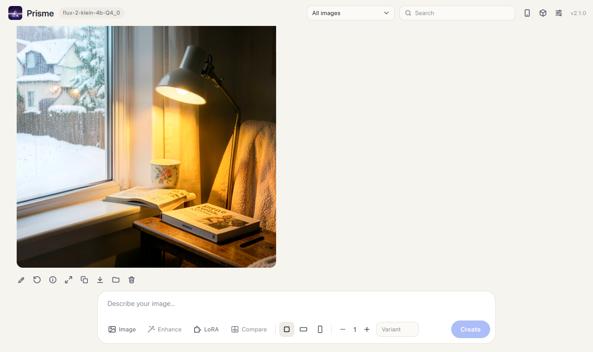

# Prisme

Application locale pour créer et modifier des images par intelligence artificielle sur Windows. Tout tourne sur ton PC : pas de compte, pas d'abonnement, pas d'envoi de tes images sur Internet. Le calcul est fait par la carte graphique grâce à [stable-diffusion.cpp](https://github.com/leejet/stable-diffusion.cpp).



## Fonctions

- **Création** d'images à partir d'une description, de 1 à 4 images par lancement
- **Amélioration de la description** par un modèle de langage local (Ollama), à la demande ou automatiquement, en création comme en modification
- **Modification** d'une image existante : glisser, coller ou choisir une image de départ
- **Formats** carré, paysage, portrait, ou proportions de l'image de départ
- **Historique** avec recherche, visionneuse plein écran, réutilisation de la description et du seed, mise à la corbeille
- **Réglages** : choix des modèles, LoRA, étapes, CFG, échantillonneur, sigmas, options mémoire
- **Téléphone** : utilisation depuis un téléphone sur le même Wi-Fi, protégée par un code d'accès (QR code)
- **Exécutable** Windows unique, sans Python à installer

## Prérequis

- Windows 10 ou 11 avec une carte graphique NVIDIA (8 Go de mémoire vidéo ou plus conseillés)
- [stable-diffusion.cpp](https://github.com/leejet/stable-diffusion.cpp/releases), version CUDA pour Windows
- Des modèles compatibles avec stable-diffusion.cpp, au format GGUF ou safetensors

Facultatif : [Ollama](https://ollama.com) avec un modèle de langage, pour améliorer les descriptions.

Prisme pilote les modèles qui fonctionnent avec un modèle de diffusion, un encodeur de texte de type LLM (`--llm`), un VAE et, pour la modification d'image, un encodeur d'image (`--llm_vision`).

## Installation

1. Télécharge `Prisme.exe` depuis la page [Releases](../../releases), ou construis-le (voir plus bas).
2. Crée cette structure à côté de l'exe :

   ```
   Prisme.exe
   sd/        sd-cli.exe et ses DLL (archive de stable-diffusion.cpp)
   models/    tes modèles .gguf / .safetensors
     loras/   tes LoRA (facultatif)
   ```

3. Lance `Prisme.exe`. Au premier lancement, l'application indique ce qui manque : clique sur **Choisir les modèles** et sélectionne un fichier pour chaque rôle.

Au premier lancement, Windows peut demander d'autoriser l'accès au réseau. Accepte si tu veux utiliser Prisme depuis ton téléphone.

## Utilisation

| Action | Comment |
|---|---|
| Générer | Écrire une description puis **Générer**, ou `Ctrl` + `Entrée` |
| Modifier une image | **Modifier** sous une image, ou glisser une image dans « Image de départ » |
| Changer de modèle | **Réglages → Modèles**, puis **Enregistrer** |
| Ajouter un LoRA | Le placer dans `models/loras`, puis **Réglages → LoRA → Actualiser** |
| Utiliser le téléphone | **Téléphone** en haut à droite, puis scanner le QR code |
| Parcourir l'historique | Clic sur une vignette, ou flèches ← → |

Les réglages sont enregistrés dans `app/reglages.json`, les images dans `images/`. L'application s'arrête seule après 30 minutes sans fenêtre ouverte (modifiable dans les Réglages).

### Amélioration de la description

Une description courte (« un chat sur un toit la nuit ») donne souvent une image moins réussie qu'une description détaillée. Prisme peut la faire réécrire par un modèle de langage servi par Ollama :

1. Installe [Ollama](https://ollama.com) et télécharge un modèle de langage (`ollama pull <modèle>`).
2. Dans **Réglages → Amélioration de la description**, choisis ce modèle.
3. Clique sur **Améliorer** au-dessus de la description : le texte détaillé remplace le tien, tu peux le modifier, et **Rétablir** revient à ton texte.

Avec une image de départ, l'amélioration ne décrit pas une nouvelle scène : elle transforme ta demande (« ajoute de la neige ») en consigne de modification précise, qui nomme les éléments à changer et demande de garder tout le reste identique. Si le modèle de langage sait lire les images, comme les modèles de vision, Prisme lui envoie l'image de départ pour qu'il s'appuie sur ce qu'elle contient.

L'option **Améliorer automatiquement** le fait avant chaque génération. Les deux consignes (création et modification) et l'adresse d'Ollama se changent dans les Réglages. Le modèle de langage est déchargé de la carte graphique dès sa réponse, pour laisser la place à la génération.

### Téléphone

Le téléphone doit être sur le même réseau que le PC. Le lien du QR code contient un code d'accès enregistré dans `app/code-acces.txt` : supprimer ce fichier puis relancer Prisme en crée un nouveau et déconnecte les appareils déjà reliés.

## Construire depuis les sources

Avec Python 3 installé :

```powershell
powershell -ExecutionPolicy Bypass -File .\construire.ps1
```

Le script crée un environnement dans `.construction/`, y installe PyInstaller et Pillow, puis produit `Prisme.exe` à la racine.

Pour lancer sans construire :

```powershell
py -3 app\serveur.py
```

## Structure du code

| Fichier | Rôle |
|---|---|
| `app/serveur.py` | Serveur local (bibliothèque standard Python uniquement) : API, lancement de sd-cli, accès réseau |
| `app/index.html` | Interface complète : HTML, CSS et JavaScript sans dépendance |
| `app/icone.py` | Dessin de l'icône de l'exécutable |
| `construire.ps1` | Construction de `Prisme.exe` |
