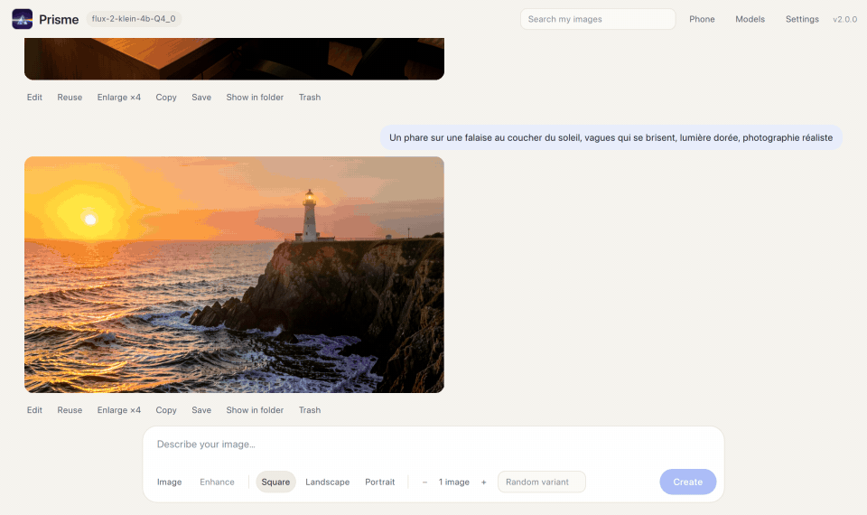

<p align="center">
  
</p>

<h1 align="center">Prisme</h1>

<p align="center">
  <strong>Local AI image generation and editing for Windows, macOS and Linux. One program, no Python, nothing sent to the cloud.</strong>
</p>

<p align="center">
  <a href="https://github.com/d3Ita/prisme/releases/latest"></a>
  <a href="https://github.com/d3Ita/prisme/actions/workflows/tests.yml"></a>
  <a href="LICENSE"></a>
  <br>
  
  
  
  
  <a href="https://github.com/leejet/stable-diffusion.cpp"></a>
  
  
</p>

<p align="center">
  <strong>English</strong> · <a href="README.fr.md">Français</a>
</p>

<p align="center">
  <a href="#quick-start">Quick start</a> ·
  <a href="#features">Features</a> ·
  <a href="#recommended-models">Models</a> ·
  <a href="#phone-access">Phone access</a> ·
  <a href="#security">Security</a> ·
  <a href="#build-from-source">Build</a> ·
  <a href="CONTRIBUTING.md">Contributing</a>
</p>



## Why Prisme?

Most local image tools ask you to install Python, manage dependencies, or wire nodes together. Prisme is a single 9 MB program for Windows, macOS and Linux: download it, add your models, click **Install engine**, and start creating. Everything runs on your own GPU through [stable-diffusion.cpp](https://github.com/leejet/stable-diffusion.cpp). No account, no subscription, and your images never leave your PC.

| | Prisme | Node-based tools (ComfyUI…) |
|---|---|---|
| Install | One program, engines installed in one click | Python, dependencies, custom nodes |
| Learning curve | A text box and a Generate button | Graphs of nodes |
| Phone access | Built in | Extra setup |
| Advanced workflows | Settings, LoRA, samplers | Virtually unlimited |

Prisme aims to be the simplest way to run image models locally, not the most powerful one.

## Features

- **Create** images from a description, 1 to 4 per run
- **Enhance prompts** with a local language model: a short idea becomes a detailed description, and an edit request becomes a precise instruction that keeps the rest of the image intact
- **Edit** an existing image: drag, paste or pick a starting image
- **Formats**: square, landscape, portrait, or the starting image's proportions
- **History** with search, full-screen viewer, reuse of prompt and seed, and delete to the Recycle Bin or Trash
- **Settings**: models, LoRA, steps, CFG, sampler, sigmas, memory options
- **Phone access** on the same Wi-Fi: type the address, approve the device on the PC
- **Automatic engine install** on first launch, from pinned official releases verified by SHA-256

## Requirements

| System | Download | GPU | Status |
|---|---|---|---|
| Windows 10 or 11 | `Prisme.exe` | NVIDIA (CUDA), 8 GB of VRAM or more recommended | Tested |
| macOS 13 or later | `Prisme-macOS-arm64.zip` | Apple Silicon (M1 or later, Metal), 16 GB of memory or more recommended | Experimental |
| Linux x64 (Ubuntu 24.04 or similar) | `Prisme-Linux-x64.tar.gz` | Any GPU with a Vulkan driver | Experimental |

You also need models compatible with stable-diffusion.cpp (GGUF or safetensors, see [Recommended models](#recommended-models)) and an internet connection on first launch, to install the engines.

Prisme drives models that use a diffusion model, an LLM text encoder (`--llm`), a VAE and, for editing, an image encoder (`--llm_vision`). The interface is in French.

## Quick start

1. Download the file for your system from the [Releases](../../releases) page.
2. Put your models in a `models` folder (LoRA go in `models/loras`): next to the program on Windows and Linux, in `~/Prisme/models` on macOS.
3. Start Prisme and click **Installer le moteur** (Install engine): Prisme downloads stable-diffusion.cpp once (about 925 MB on Windows with CUDA, under 40 MB on macOS and Linux).
4. Click **Choisir les modèles** (Choose models) and pick a file for each role.

```
Prisme.exe    (prisme on Linux, Prisme.app on macOS)
models/       your .gguf / .safetensors models
  loras/      your LoRA (optional)
sd/           image engine, installed by Prisme
llama/        text engine, installed by Prisme if you enable it
images/       your images
```

Engines come from pinned official releases of [stable-diffusion.cpp](https://github.com/leejet/stable-diffusion.cpp) and [llama.cpp](https://github.com/ggml-org/llama.cpp). Prisme checks the SHA-256 of each file before installing it.

### Windows

`Prisme.exe` is not code-signed (a signing certificate costs money) and is built with PyInstaller, which antivirus software sometimes flags by mistake. If **Windows SmartScreen** appears, click **More info**, then **Run anyway**. To check that your file is the published one, compare its SHA-256 with the one in the release notes:

```powershell
Get-FileHash .\Prisme.exe -Algorithm SHA256
```

### macOS

Unzip `Prisme-macOS-arm64.zip` and move **Prisme.app** to Applications. The app is not notarized, so macOS blocks it on first launch: open **System Settings → Privacy & Security** and click **Open Anyway**, or run once:

```bash
xattr -dr com.apple.quarantine /Applications/Prisme.app
```

Prisme keeps its data in `~/Prisme` (models, engines, images and settings), because an app bundle cannot hold them.

### Linux

```bash
tar -xzf Prisme-Linux-x64.tar.gz
./prisme
```

The engines need OpenMP and Vulkan. If Prisme reports missing libraries, install them with `sudo apt install libgomp1 libvulkan1`, plus the Vulkan driver of your GPU (for example `mesa-vulkan-drivers`). Prisme opens as an app window in Chrome, Chromium, Edge or Brave when one is installed, otherwise in your default browser.

You can also build Prisme yourself or run `app/serveur.py` directly on any system.

## Recommended models

These official, general-purpose models work with Prisme. Each link opens the model page on Hugging Face: download the files into your `models` folder. The same links are in **Réglages** (Settings), next to each role.

| Role in Prisme | Recommended file | Where to find it | Lighter option |
|---|---|---|---|
| Modèle de dessin (diffusion model) | `Q5_K`, `Q6_K` or `Q8_0` GGUF | [Qwen-Image-2.1-Turbo-GGUF](https://huggingface.co/AtomicChat/Qwen-Image-2.1-Turbo-GGUF) | `Q4_K` |
| Encodeur de texte (text encoder) | `Qwen3VL-8B-Instruct-Q8_0.gguf` (8.7 GB) | [Qwen3-VL-8B-Instruct-GGUF](https://huggingface.co/Qwen/Qwen3-VL-8B-Instruct-GGUF) | `Q4_K_M` (5 GB): edits look grainier |
| Vision (image encoder, for editing) | `mmproj-Qwen3VL-8B-Instruct-F16.gguf` (1.2 GB) | [Qwen3-VL-8B-Instruct-GGUF](https://huggingface.co/Qwen/Qwen3-VL-8B-Instruct-GGUF) | `mmproj` `Q8_0` |
| VAE | `vae/diffusion_pytorch_model.safetensors` (675 MB) | [Qwen-Image-2.1-Turbo](https://huggingface.co/Qwen/Qwen-Image-2.1-Turbo/tree/main/vae) | |
| Modèle de langage (prompt enhancement) | The same text encoder and vision files | [Qwen3-VL-8B-Instruct-GGUF](https://huggingface.co/Qwen/Qwen3-VL-8B-Instruct-GGUF) | [Qwen3-VL-4B-Instruct-GGUF](https://huggingface.co/Qwen/Qwen3-VL-4B-Instruct-GGUF) |

This Turbo model needs few steps. In **Réglages → Génération**, use 8 steps, CFG 1, the `euler` method and these sigmas:

```
1.0,0.978453,0.95418,0.926626,0.89508,0.845148,0.704534,0.414568,0.0
```

You can rename the VAE file (for example `qwen-image-vae.safetensors`) so it is easy to spot. Check each model's license on its page before using it.

## Prompt enhancement

A short prompt ("a cat on a roof at night") usually gives a weaker image than a detailed one. Prisme can rewrite it with a language model running on your PC:

1. Put a GGUF language model in `models` (and its `mmproj` vision file so it can see images).
2. In **Réglages → Amélioration de la description**, keep the **Intégré** engine, click **Installer le moteur** (llama.cpp, about 290 MB, once), then choose the model and vision file.
3. Click **Améliorer** above the prompt. **Rétablir** brings your text back.

With a starting image, the model looks at the picture and writes an edit instruction that only describes what changes. The language model runs only for the time of the request, then frees the GPU for generation. If you already use [Ollama](https://ollama.com), you can select it instead.

## Phone access

Network access is **off by default**. Turn it on in **Réglages → Application → Accès depuis le téléphone**, restart Prisme and allow it through your firewall if your system asks. The **Téléphone** button then shows the address to type, for example `192.168.1.22:7861`.

On the phone, open that address: it shows a 4-digit code, and Prisme asks you on the PC to **Autoriser** (approve) the device after checking the code matches. The phone then stays connected. A QR code is also available for a direct connection. Don't enable network access on public Wi-Fi: the connection is not encrypted.

To stop Prisme, click **Quitter** or close its window: the server shuts down a few seconds later.

## Security

- The server only listens on your PC unless phone access is enabled.
- Other devices need a random 128-bit access code, received through the QR code or after you approve them on the PC. After 10 wrong codes or refused requests, a device is blocked for 15 minutes.
- Websites open in your browser can neither control Prisme nor read its data: requests from another origin or host name are rejected.
- Settings, models and folders are only reachable from the PC.

## Build from source

On the system you build for, with Python 3.12 or later, PyInstaller and Pillow installed:

```bash
python3 construire.py
```

On Windows, `powershell -ExecutionPolicy Bypass -File .\construire.ps1` first creates that environment in `.construction/`. The build runs the tests, then makes `Prisme.exe` (Windows), `dist/Prisme-macOS-arm64.zip` (macOS) or `dist/Prisme-Linux-x64.tar.gz` (Linux). If a test fails, nothing is built. To run without building: `python3 app/serveur.py`.

```bash
python3 -m unittest discover -s tests -v
```

The tests cover settings validation, image metadata, engine installation, archive extraction, model links and access protections. They run in a temporary folder, and GitHub runs them on Windows and Linux for every push, then builds both versions. The macOS version is built on demand.

| File | Role |
|---|---|
| `app/serveur.py` | Local server, Python standard library only: API, engines, network access |
| `app/index.html` | The whole interface: HTML, CSS and JavaScript with no dependency |
| `app/icone.py` | Program icon and splash screen, made from the logo |
| `construire.py` | Builds Prisme for the current system |
| `construire.ps1` | Prepares a Python environment on Windows, then runs `construire.py` |
| `tests/test_serveur.py` | Server tests |

## Responsible use

Prisme is designed for legal and ethical use. Each user is solely responsible for the images they create, edit or share with Prisme, and must respect the law of their country and the rights and image of other people.

The author of Prisme accepts no liability for any abusive, illegal or unethical use of the software. As stated in the [MIT license](LICENSE), Prisme is provided "as is", without warranty of any kind.

## License

Prisme is released under the [MIT license](LICENSE).
