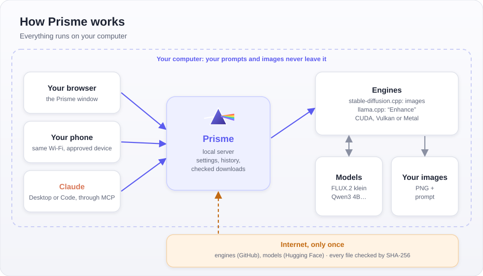
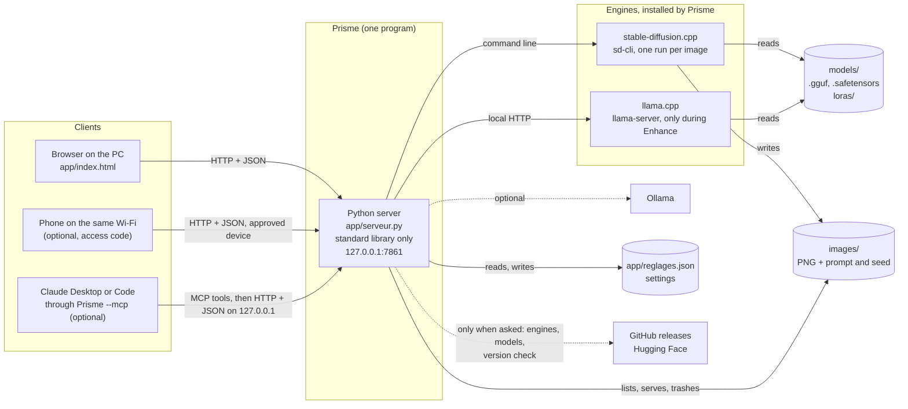
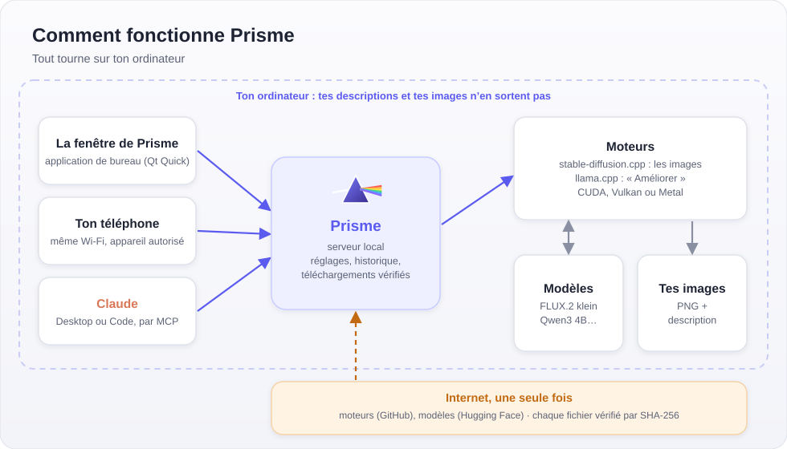

# Prisme architecture · Architecture de Prisme

**English** · [Français](#français)

In more detail:

## How it works

- **The interface** is a single HTML page (`app/index.html`, no dependency) opened in a browser window. It only talks to the local server, with JSON requests.
- **The server** (`app/serveur.py`) uses the Python standard library only. It listens on `127.0.0.1:7861` (`PRISME_PORT` changes the port), checks every request (host name, origin, access code for other devices), keeps the settings and drives the engines.
- **Creating or editing an image** starts `sd-cli` from stable-diffusion.cpp once per image, with the drawing model, the text model, the VAE and, for an edit, the vision file. The server reads its progress from the console output, and `sd-cli` writes a PNG to `images/` with the prompt and seed in its metadata.
- **Enhance** starts `llama-server` from llama.cpp on a free local port, sends it the description (and the starting image if the model can see), then stops it to free the graphics card. Ollama can be used instead.
- **Downloads** happen only when you ask: the engines come from pinned official GitHub releases and the models from Hugging Face, and every file is checked against its SHA-256. The only automatic request is the version check at launch, which can be turned off.
- **The phone** connects to the same server over the local network, only if phone access is turned on and the device is approved on the PC.
- **Claude** can drive Prisme through the MCP server built into the program (`Prisme --mcp`, `app/mcp_prisme.py`): Claude starts it on the same computer, it calls the same API on `127.0.0.1`, starts Prisme if needed and copies the images to its own folder. Downloads under a non-commercial license or outside the catalog wait for the user's click in Prisme's window.

On macOS, `models/`, `images/`, the engines and the settings live in `~/Prisme`. On Windows and Linux, they sit next to the program.

---

## Français

Le schéma ci-dessus montre les mêmes éléments : le navigateur du PC et, si tu les actives, le téléphone et Claude (MCP) parlent au serveur Python ; le serveur lance les moteurs, qui lisent les modèles et écrivent les images.

- **L'interface** est une seule page HTML (`app/index.html`, sans dépendance) ouverte dans une fenêtre de navigateur. Elle ne parle qu'au serveur local, par des requêtes JSON.
- **Le serveur** (`app/serveur.py`) n'utilise que la bibliothèque standard de Python. Il écoute sur `127.0.0.1:7861` (`PRISME_PORT` change le port), contrôle chaque requête (nom d'hôte, origine, code d'accès pour les autres appareils), garde les réglages et pilote les moteurs.
- **Créer ou modifier une image** lance `sd-cli` (stable-diffusion.cpp) une fois par image, avec le modèle de dessin, le modèle de texte, le VAE et, pour une modification, le fichier de vision. Le serveur suit l'avancement dans la sortie de la console, et `sd-cli` écrit un PNG dans `images/` avec la description et la graine dans ses métadonnées.
- **Améliorer** lance `llama-server` (llama.cpp) sur un port local libre, lui envoie la description (et l'image de départ si le modèle sait voir), puis l'arrête pour libérer la carte graphique. Ollama peut le remplacer.
- **Les téléchargements** n'ont lieu qu'à ta demande : les moteurs viennent des versions officielles épinglées sur GitHub, les modèles de Hugging Face, et chaque fichier est vérifié par son empreinte SHA-256. La seule requête automatique est la recherche de nouvelle version au lancement, qui se désactive.
- **Le téléphone** se connecte au même serveur par le réseau local, seulement si l'accès depuis le téléphone est activé et que l'appareil est autorisé sur le PC.
- **Claude** peut piloter Prisme par le serveur MCP intégré au programme (`Prisme --mcp`, `app/mcp_prisme.py`) : Claude le lance sur le même ordinateur, il appelle la même API sur `127.0.0.1`, lance Prisme si besoin et copie les images dans son propre dossier. Les téléchargements sous licence non commerciale ou hors catalogue attendent le clic de l'utilisateur dans la fenêtre de Prisme.

Sous macOS, `models/`, `images/`, les moteurs et les réglages sont dans `~/Prisme`. Sous Windows et Linux, ils sont à côté du programme.
